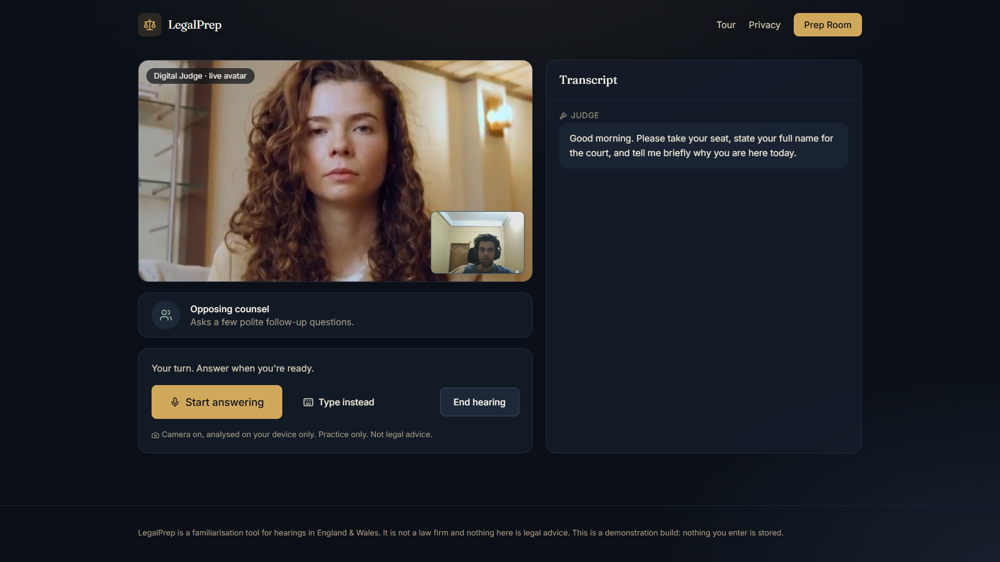
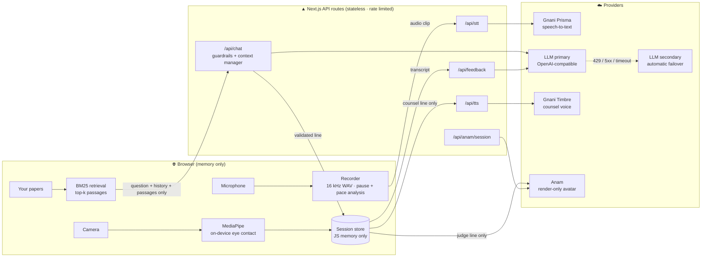
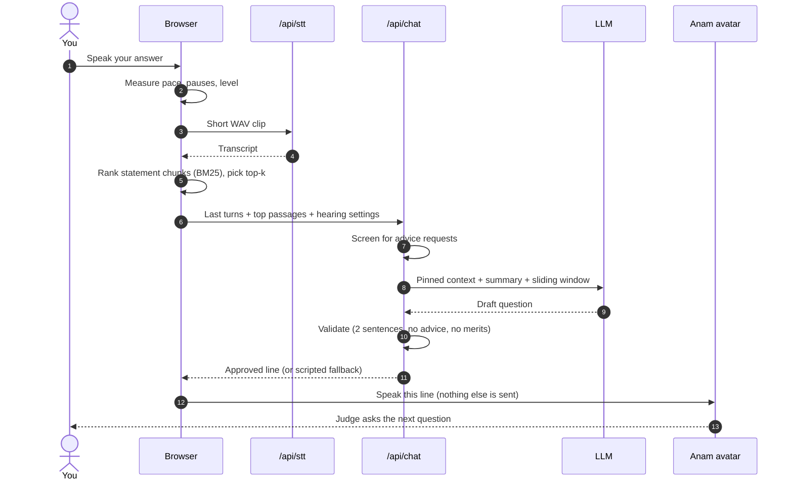
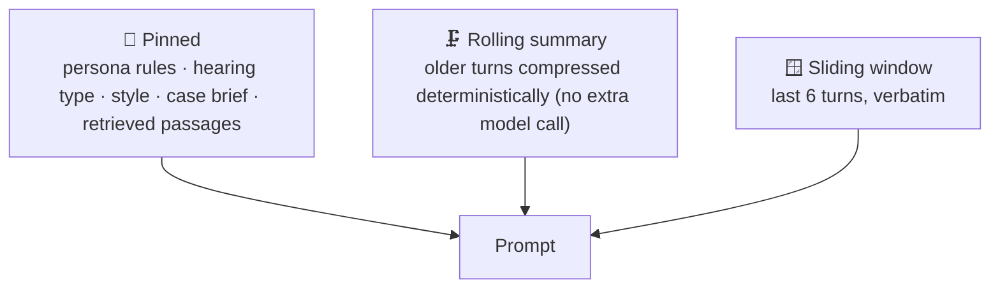
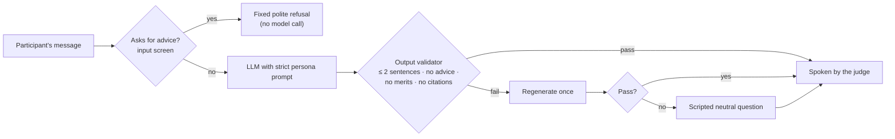

<div align="center">

# ⚖️ LegalPrep

### Walk into the courtroom before the day you have to.

A virtual courtroom with a live **Digital Judge**. Practise answering questions out loud, get honest feedback on how you *delivered* your words, and build composure for a hearing in England & Wales.

**[▶ Try the live demo](https://legal-prep.vercel.app/)**

     

<br />



<sub>The hearing room: a live avatar judge, an optional opposing counsel, and a running transcript.</sub>

</div>

---

> **Familiarisation, never advice.** LegalPrep helps people feel less afraid of a hearing by letting them rehearse one. It does not tell anyone what to say, judge the merits of a case, or state the law. It only comments on *how* an answer was delivered.
>
> Independent demonstration build. Not affiliated with any real product or law firm.

## ✨ The experience

| | Step | What happens |
|---|---|---|
| 🏛️ | **Tour** | A guided walk through the room so you know who is who and where to sit. |
| 📄 | **Prep Room** | Optionally add a witness statement and a short case summary. Choose the hearing type and how gentle or probing the questions should be. |
| 🎙️ | **Hearing** | A Digital Judge (and, if you like, a polite opposing counsel) asks short factual questions. Answer by voice or type. |
| 📷 | **Camera (optional)** | Practise steady eye contact. Analysed on your device only, and never uploaded. |
| 📊 | **Feedback** | Pace, filler words, pauses, clarity, directness, relevance, eye contact, and an answer-by-answer table you can print. |

**Hearing types:** civil claim · small claims · family · employment tribunal · housing/tenancy
**Question styles:** gentle · standard · probing (always courteous)

## 🧠 Architecture



### One turn, end to end



The avatar provider receives **only the lines the judge speaks**. It never receives your voice, camera, papers or transcript (its own microphone input is disabled).

## 🧩 How it works under the hood

### 1. Conversation context management
Long hearings must not make responses slower or dearer, so each turn is assembled in three layers (`lib/context.ts`):



An 18-turn test conversation still produced a prompt of roughly 600 tokens.

### 2. Ephemeral RAG over your own papers
Papers must never be persisted, so there is no database to write to and no index to clean up. Instead (`lib/rag.ts`):

1. The statement is chunked **in your browser** (paragraph-aware, with overlap).
2. Chunks are ranked with **BM25** against your latest answer, the last question and the case summary.
3. **Only the top passages** are sent to the model, not the whole document.

Less sensitive text leaves the device, prompts stay small, latency and cost drop, and clearing the tab clears everything. The same interface can be backed by pgvector and embeddings for a public corpus (see the roadmap).

### 3. Defence-in-depth guardrails


Feedback text from the model is filtered separately so it can only talk about delivery.

### 4. Reliability, speed and cost
- **Retry, then failover:** one quick retry on 429, 5xx or timeout, then an automatic switch to a secondary LLM (`LLM2_*`).
- **Graceful degradation:** avatar falls back to the previous look, then to voice only; speech-to-text failure falls back to typing; no LLM key falls back to a scripted judge.
- **Rate limiting** on every route to protect paid keys (in-memory per instance; Redis recommended at scale).
- **Observability without content:** add `?debug=1` to `/hearing` for a per-turn table of STT, chat and model latency, source, estimated tokens and passages used.
- **Security headers:** CSP, HSTS, Permissions-Policy, no `X-Powered-By`.

Typical measured latency during development: **roughly 0.4 to 1.2 s** from answer to approved question.

## 🔒 Privacy by design

| Data | Where it lives | Lifetime |
|---|---|---|
| Papers & case summary | Browser memory. Only the best passages reach the model. | Cleared on finish, remove, or closing the tab |
| Voice | A short clip goes to speech-to-text | Not stored by this app |
| Camera frames | Analysed on-device by MediaPipe | Never leave the browser |
| Avatar provider | Receives only the judge's spoken lines | Session ends with the hearing |
| Transcript & scores | JS memory | Gone on refresh |

No accounts, database, cookies, analytics or advertising trackers. API routes never log content. No face template, voiceprint or biometric identification is created, and nothing is designed to infer honesty, emotion or the merits of a case.

## 🛠️ Tech stack

| Layer | Choice |
|---|---|
| App | Next.js 14 (App Router), React 18, TypeScript (strict), Tailwind CSS, shadcn-style components |
| Avatar | Anam JS SDK, custom-LLM mode (render-only) |
| Speech | Gnani Prisma (speech-to-text) and Timbre (counsel voice) |
| Language model | Any OpenAI-compatible endpoint; developed with Groq `openai/gpt-oss-120b` |
| Eye contact | MediaPipe Face Landmarker (WASM, on-device) |
| Validation | Zod |
| Quality | Vitest (32 tests), ESLint, GitHub Actions CI |
| Hosting | Vercel |

## 🚀 Run it yourself

```bash
git clone https://github.com/Shyamistic/Legal-Prep.git
cd Legal-Prep
cp .env.example .env.local     # add your keys
npm install
npm run dev                     # http://localhost:3000
npm test                        # 32 unit tests
```

| Variable | Purpose |
|---|---|
| `ANAM_API_KEY` | Live judge avatar |
| `GNANI_API_KEY` | Speech-to-text and counsel voice |
| `LLM_BASE_URL` · `LLM_API_KEY` · `LLM_MODEL` | Question logic (any OpenAI-compatible provider) |
| `LLM2_*` | Optional second provider for automatic failover |
| `NEXT_PUBLIC_SITE_URL` | Link previews |

Without an LLM key the app still works using a scripted judge. `.env.local` is git-ignored; only `.env.example` is committed.

### Deploy
Push to GitHub, import the repo into [Vercel](https://vercel.com/new), add the variables above, deploy. No other configuration is needed.

## 🗺️ Project map

```
app/
  page.tsx · tour/ · prep/ · hearing/ · feedback/ · privacy/   UI
  api/chat · stt · tts · feedback · anam/session · health      stateless routes
lib/
  context.ts     three-layer context manager, hearing types and styles
  rag.ts         chunking + BM25 retrieval
  guardrails.ts  advice screen, output validator, feedback filter
  llm.ts         OpenAI-compatible client, retry + failover
  audio.ts       recorder, WAV encoding, pause detection
  gaze.ts        on-device eye contact
  metrics.ts     WPM, fillers, pauses, scores
  ratelimit.ts   sliding-window limiter
tests/           guardrails · retrieval · context · metrics
```

## 🔭 Roadmap
- Embedding retrieval (pgvector) over public procedure guidance for procedural familiarisation.
- Stream model tokens into the avatar sentence by sentence to cut time to first word.
- Accounts, session credits (Stripe), reminders (Resend), scheduled deletion.
- Redis-backed rate limits, tracing and cost dashboards.
- Custom judge avatar in a full courtroom setting.
- PDF and Word statement upload.

---

<div align="center"><sub>Built to make a frightening day a little more familiar.</sub></div>
